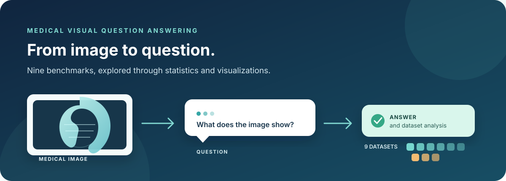

<div align="center">

# Med-VQA Survey

### Una mirada descriptiva a nueve benchmarks de *Medical Visual Question Answering*

**Análisis exploratorio y visualizaciones para entender cómo se formulan y responden preguntas sobre imágenes médicas.**

[](https://colab.research.google.com/github/AlbertP97/Med-VQA-Survey/)




</div>

## ¿De qué trata?

Este repositorio acompaña el análisis de una encuesta sobre **Medical Visual Question Answering (Med-VQA)**. Contiene nueve notebooks de Jupyter, uno por benchmark, que reproducen análisis estadísticos descriptivos y visualizaciones de sus datos. La idea es facilitar la exploración de las características de cada conjunto —y de sus diferencias—, no entrenar ni comparar modelos.

Según los campos disponibles en cada dataset, los notebooks exploran aspectos como el número de imágenes, preguntas y respuestas; la frecuencia de tipos de pregunta y respuesta; las preguntas y respuestas más comunes; la longitud del texto; y distribuciones o relaciones entre variables como modalidad, anatomía, órgano o dificultad. El alcance y las variables **no son idénticos en todos los notebooks**.

## Notebooks

| Benchmark | Notebook | Enfoque destacado |
| --- | --- | --- |
| DME-VQA | [DME_VQA.ipynb](DME_VQA.ipynb) · [Colab](https://colab.research.google.com/github/AlbertP97/Med-VQA-Survey/blob/main/DME_VQA.ipynb) | Tipos de pregunta, preguntas y respuestas frecuentes; cruces por tipo y centro. |
| Kvasir-VQA | [Kvasir_VQA.ipynb](Kvasir_VQA.ipynb) · [Colab](https://colab.research.google.com/github/AlbertP97/Med-VQA-Survey/blob/main/Kvasir_VQA.ipynb) | Complejidad, preguntas y respuestas frecuentes, y longitud del texto. |
| MedFrameVQA | [MedFrameVQA.ipynb](MedFrameVQA.ipynb) · [Colab](https://colab.research.google.com/github/AlbertP97/Med-VQA-Survey/blob/main/MedFrameVQA.ipynb) | Distribuciones de modalidad, órgano y sistema, además de longitudes de preguntas y respuestas. |
| PMC-VQA | [PMC_VQA.ipynb](PMC_VQA.ipynb) · [Colab](https://colab.research.google.com/github/AlbertP97/Med-VQA-Survey/blob/main/PMC_VQA.ipynb) | Contenido radiológico, opciones de respuesta y estadísticas de texto y pies de imagen. |
| PathVQA | [PathVQA.ipynb](PathVQA.ipynb) · [Colab](https://colab.research.google.com/github/AlbertP97/Med-VQA-Survey/blob/main/PathVQA.ipynb) | Tipos de pregunta y respuesta, frecuencias y distribución de longitudes. |
| SLAKE | [SLAKE.ipynb](SLAKE.ipynb) · [Colab](https://colab.research.google.com/github/AlbertP97/Med-VQA-Survey/blob/main/SLAKE.ipynb) | Tipos de respuesta, preguntas frecuentes y cruces entre variables. |
| VQA-MED 2019 | [VQA_MED_2019.ipynb](VQA_MED_2019.ipynb) · [Colab](https://colab.research.google.com/github/AlbertP97/Med-VQA-Survey/blob/main/VQA_MED_2019.ipynb) | Análisis descriptivo de preguntas, respuestas e imágenes. |
| VQA-RAD | [VQA_RAD.ipynb](VQA_RAD.ipynb) · [Colab](https://colab.research.google.com/github/AlbertP97/Med-VQA-Survey/blob/main/VQA_RAD.ipynb) | Preguntas y respuestas por tipo, cruces con órgano y resumen visual. |
| ViDr-CXR-VQA | [ViDr_CXR_VQA.ipynb](ViDr_CXR_VQA.ipynb) · [Colab](https://colab.research.google.com/github/AlbertP97/Med-VQA-Survey/blob/main/ViDr_CXR_VQA.ipynb) | Análisis a nivel de imagen y de pares pregunta-respuesta, con dificultad y justificaciones. |

## Cómo empezar

1. Abre el notebook del benchmark que quieras explorar (los enlaces de la tabla llevan a GitHub o a Google Colab).
2. Revisa las primeras celdas: cada notebook documenta sus dependencias y su propia forma de cargar los datos.
3. Proporciona los archivos de datos que ese notebook espera —por ejemplo, mediante la carga en Colab o la ruta indicada— y ejecuta las celdas en orden.
4. Inspecciona las tablas, estadísticas y gráficos generados; adapta las rutas o la configuración de carga si tu entorno lo requiere.

> **Datos:** los notebooks están versionados aquí, pero los datasets no. El acceso, formato y nombre de los archivos pueden variar entre benchmarks; consulta las instrucciones del notebook correspondiente y obtén los datos desde su fuente autorizada.

## Estructura

```text
.
├── DME_VQA.ipynb
├── Kvasir_VQA.ipynb
├── MedFrameVQA.ipynb
├── PMC_VQA.ipynb
├── PathVQA.ipynb
├── SLAKE.ipynb
├── VQA_MED_2019.ipynb
├── VQA_RAD.ipynb
├── ViDr_CXR_VQA.ipynb
├── assets/
│   └── med-vqa-overview.svg
└── README.md
```

## Alcance y uso responsable

Estos notebooks sirven para **exploración y análisis de datos de investigación**; no son una herramienta de diagnóstico ni de apoyo a decisiones clínicas. Antes de descargar o utilizar un dataset, revisa sus condiciones de acceso, licencia y requisitos éticos. Los resultados pueden depender de la versión, el preprocesamiento y los archivos suministrados a cada notebook.

## Cita y referencia

Este código reproduce análisis y visualizaciones relacionados con una encuesta de Med-VQA. Cuando se publique la referencia bibliográfica del artículo, añádela aquí junto con el formato de cita recomendado.
